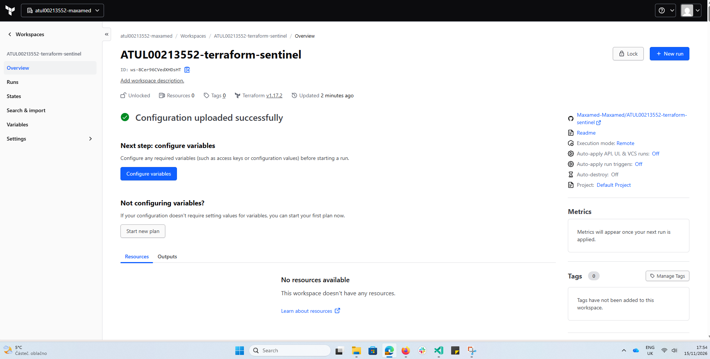
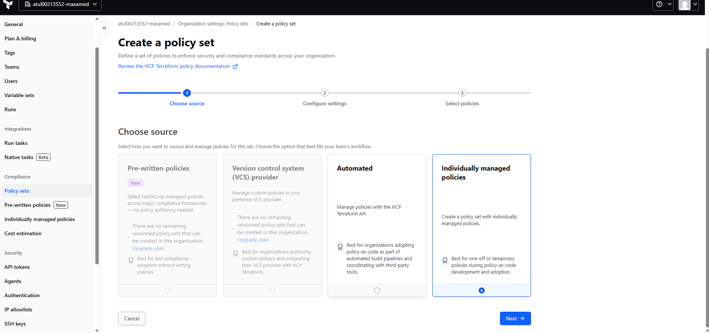
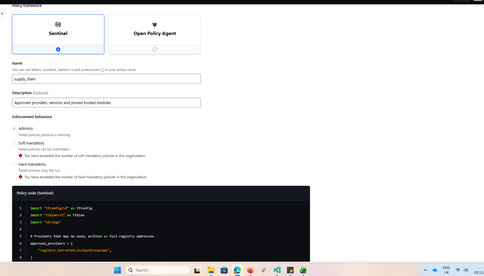
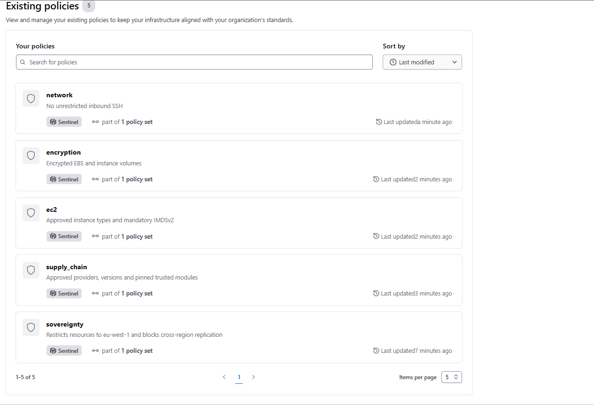
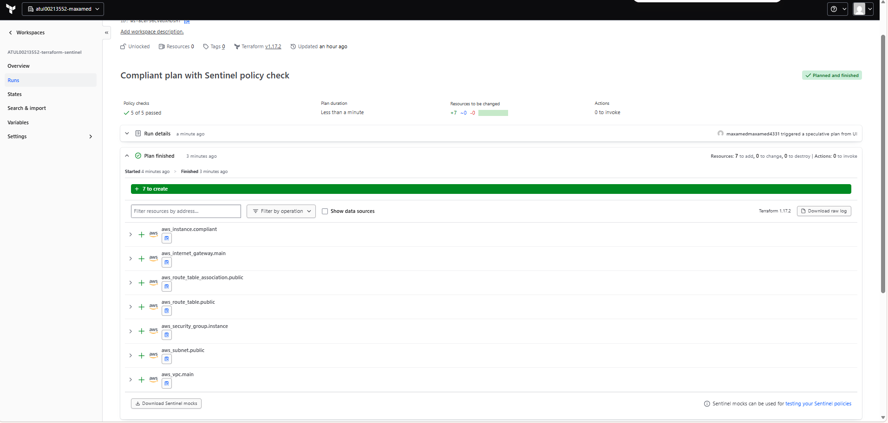
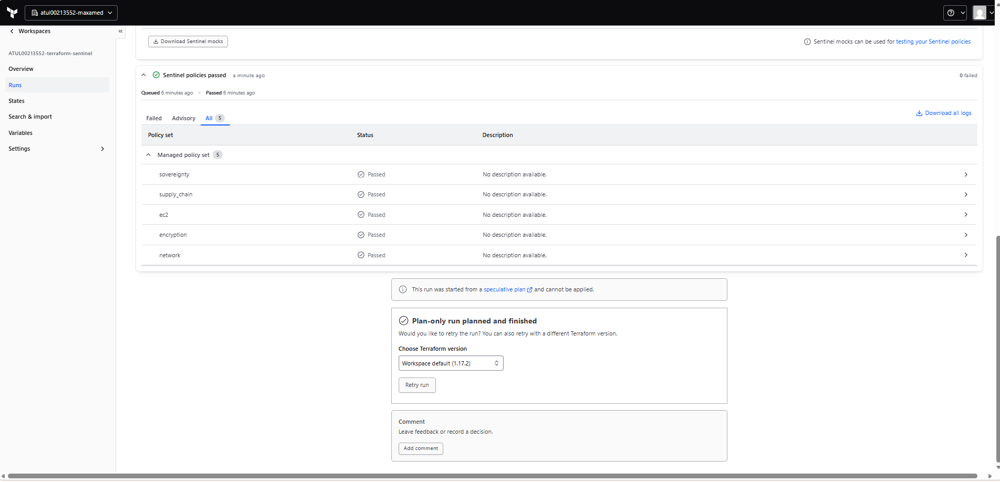
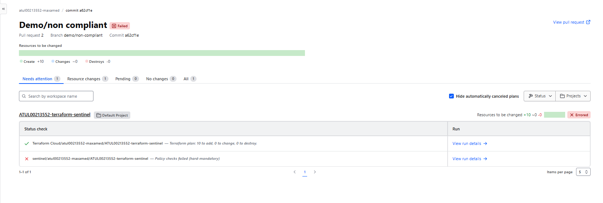
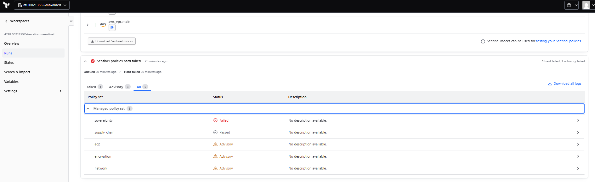
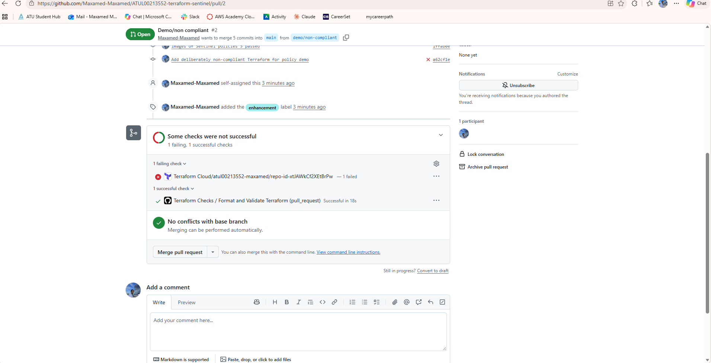
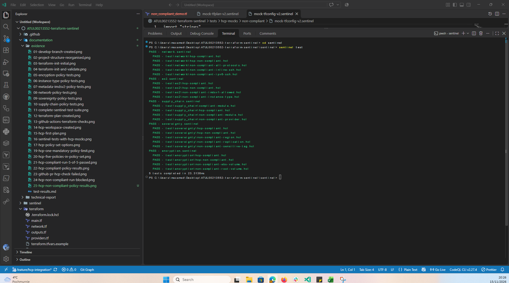

# ATUL00213552 Terraform Digital Sovereignty Assignment

## Overview

This repository holds a Policy as Code framework for an organisation that must keep its infrastructure and data in Ireland. Terraform describes a small AWS environment. HashiCorp Sentinel checks every plan before anything is applied, and HCP Terraform runs those checks on each plan for the workspace.

Five Sentinel policies cover digital sovereignty, Terraform supply chain security and EC2 infrastructure security. They were tested in two ways:

- Locally with the Sentinel CLI, using mock data downloaded from real HCP Terraform plans.
- In HCP Terraform, where a compliant plan passed all five policies and a deliberately non-compliant plan was stopped by a hard mandatory policy.

Nothing was applied to AWS. Every run was a plan only run.

| Item | Value |
|---|---|
| Student ID | ATUL00213552 |
| HCP Terraform organisation | `atul00213552-maxamed` |
| HCP Terraform workspace | `ATUL00213552-terraform-sentinel` |
| Policy set | `ireland-sovereignty-policies` |
| Approved AWS region | `eu-west-1` (Ireland) |
| AWS provider | `hashicorp/aws`, constraint `~> 6.0`, locked at 6.72.0 |
| Sentinel CLI used locally | 0.41.0 |

## Repository structure

```text
.github/workflows/terraform-checks.yml   Terraform checks and Sentinel tests in CI
documentation/evidence/                  Screenshots and test results
documentation/technical-report/          One page technical report
sentinel/                                Five policies, sentinel.hcl and test cases
terraform/                               Terraform configuration, lock file and tfplan
tests/hcp-mocks/                         Mock data downloaded from real HCP Terraform plans
tests/<policy>/                          Small mocks, one per way of failing
tests/hcp-update-test-scenarios.md                  Description of every test case
```

## Terraform configuration

The configuration in `terraform/` creates a VPC, a subnet, an internet gateway, a route table, a security group with no inbound rules and one EC2 instance. The instance uses `t3.micro`, requires IMDSv2, encrypts its root volume and is tagged `Classification = "sensitive"` and `DataResidency = "Ireland"`.

`versions.tf` restricts the AWS provider to `hashicorp/aws` with `~> 6.0`. The lock file `.terraform.lock.hcl` records the exact release (6.72.0) and its checksums, and it is committed so that a provider change shows up in code review.

The saved plan is in `terraform/tfplan`, with a readable copy in `terraform/tfplan-output.txt`.

## Sentinel policies

| Policy | What it checks | Level in HCP Terraform |
|---|---|---|
| `sovereignty.sentinel` | Every resource is in `eu-west-1`. Resources tagged sensitive carry `DataResidency = "Ireland"`. No replication or copy resources. | Hard mandatory |
| `supply_chain.sentinel` | Approved provider source and version constraint. Every resource in the plan comes from an approved provider. Modules come from a trusted namespace and are pinned to one exact version. | Advisory |
| `ec2.sentinel` | Approved instance types (`t3.micro`, `t3.small`) and mandatory IMDSv2. | Advisory |
| `encryption.sentinel` | Encrypted root volume, extra instance volumes and standalone EBS volumes. | Advisory |
| `network.sentinel` | No inbound SSH from `0.0.0.0/0` or `::/0`, in any of the three ways the AWS provider can express an ingress rule. | Advisory |

### Design decisions

**The region is checked on every resource, not on a variable.** My first version only compared the `aws_region` variable with an approved list. AWS provider 6 gives each regional resource its own `region` argument, so a single resource can be placed in another region while the variable still says `eu-west-1`. The policy now reads `region` from each resource in the plan. A resource with no region attribute fails unless its type is added to an explicit list of approved global services, which is empty.

**Replication and backups are handled by blocking the resource types that copy data.** A copy can leave Ireland even when the original is in `eu-west-1`. The policy rejects S3 bucket replication, EBS snapshot copy, AMI copy, RDS automated backup replication and DynamoDB global tables or replicas. This is a blunt rule, and a production version would allow a copy whose destination is also in Ireland.

**The root volume must be declared.** The plan data showed that the Amazon Linux AMI snapshot is not encrypted. If `root_block_device` is left out, the instance inherits that. The encryption policy therefore fails an instance that has no root volume block, and does not only check the value when one is present.

**The network policy covers all three rule styles.** An ingress rule can be written inline in `aws_security_group`, as `aws_security_group_rule`, or as `aws_vpc_security_group_ingress_rule`. My first version checked one of them, so switching style bypassed it. The policy also treats protocol `-1` (all traffic) as including SSH, and checks IPv6.

**Instance type and IMDSv2 share one file.** The HCP Terraform Free edition allows five policies in one policy set, so the two EC2 checks were merged into `ec2.sentinel`.

**Modules must be pinned to an exact version.** A constraint such as `>= 5.0` can resolve to a different release on another day, so it is rejected. The Terraform configuration does not use an external module, so the module rules are tested with mock data only.

## HCP Terraform integration

The workspace is connected to this GitHub repository with the version control workflow. The working directory is `terraform`, the tracked branch is `main`, and apply is manual. Plans run on HCP Terraform infrastructure with a temporary IAM user that has only `AmazonEC2ReadOnlyAccess`. Its access key is stored as two sensitive environment variables in the workspace and was deleted after the evidence was captured. AWS recommends attaching permissions to groups, and I attached the policy directly only because the user was temporary and single purpose.

The policy set is scoped to this workspace and runs in the platform environment.



### Two limits of the Free edition

**Policy sets cannot be connected to a repository.** The version control option is disabled on the Free edition, so I created the five policies as individually managed policies and pasted in the code from `sentinel/`. GitHub remains the source of truth, and the copy in HCP Terraform has to be updated by hand when a policy changes.



**Only one policy can be mandatory.** After `sovereignty` was created as hard mandatory, both the soft mandatory and hard mandatory options were locked for every other policy.



I gave the single mandatory slot to `sovereignty`. It is the core requirement of the assignment, and data that has left the jurisdiction cannot be brought back by fixing the configuration afterwards. The other four policies are advisory in HCP Terraform, so they report a failure on every run without stopping it. `sentinel/sentinel.hcl` records the levels as deployed. On a paid edition all five would be hard mandatory.



## Evidence

### Compliant plan

The plan for `main` creates 7 resources and passes all five policies.





### Non-compliant plan

The branch `demo/non-compliant` adds `terraform/non_compliant_demo.tf`. It is open as pull request 2 and is never merged. The file adds:

- An unencrypted EBS volume in `us-east-1`, tagged sensitive with no `DataResidency` tag.
- An `m5.large` instance that allows IMDSv1 and has an unencrypted root volume.
- An ingress rule that opens SSH to `0.0.0.0/0`.

HCP Terraform planned the pull request automatically. The plan itself succeeded with 10 resources to add, and the policy check then failed.



| Policy | Result | Effect |
|---|---|---|
| `sovereignty` | Failed, hard mandatory | The run is stopped |
| `ec2` | Failed, advisory | Reported |
| `encryption` | Failed, advisory | Reported |
| `network` | Failed, advisory | Reported |
| `supply_chain` | Passed | The demo file uses the approved provider |



The failed check is also reported on the pull request in GitHub.



Two things in this run are worth pointing out. The `m5.large` type is written directly in the resource, so the validation block on the `instance_type` variable never saw it, and Sentinel did. The demo file did not change the provider, so supply chain failures are shown through mock data in the local tests and not through an HCP Terraform run.

### Local Sentinel tests

Every policy has a test that runs against the mock data from the compliant HCP Terraform plan and expects `true`. Four policies also run against the mock data from the non-compliant plan and expect `false`. Smaller hand-written mocks then cover each way of failing on its own. There are 22 test cases across the five policies, described in `tests/hcp-update-test-scenarios.md`.



Screenshots 01 to 13 in `documentation/evidence/` record the first version of this project, which used six policies and hand-written mocks only. Screenshots 05 to 11 show those earlier policies and are kept as a record of how the work developed.

## How policy enforcement prevents non-compliant deployments

HCP Terraform runs in a fixed order: plan, then policy check, then apply. Sentinel receives the finished plan as data and each policy returns true or false. What happens next depends on the enforcement level.

| Level | When the policy fails |
|---|---|
| Hard mandatory | The run stops. Nobody can override it. |
| Soft mandatory | The run stops unless an authorised user overrides it. |
| Advisory | A warning is recorded and the run continues. |

In the non-compliant run the plan was valid Terraform and would have been applied by a pipeline with no policy step. The hard mandatory failure ended the run before the apply stage existed. The fix has to be made in the code, pushed, and planned again.

This gate only protects changes that go through HCP Terraform. GitHub still offered the merge button on the failing pull request, because `main` has no branch protection rule that requires the check.

## Decision justification

### Effectiveness of Policy as Code for digital sovereignty

Policy as Code worked well for the parts of sovereignty that appear in a Terraform plan: where a resource is placed, how it is tagged, whether it is encrypted and whether a copy is being created elsewhere. The rules are short, they are stored and reviewed like any other code, and the same rule is applied to every plan with no reliance on a reviewer noticing a region name.

Testing against real plan data mattered more than I expected. My first policies passed their hand-written mocks but did not match the real plan. `metadata_options` is a list in real plan data, not a map, and my Terraform used a root volume block and an inline security group that the first policies never looked at. A policy that passes its own tests can still be checking nothing.

The approach is weaker for everything outside the plan. Sentinel can confirm that a resource is planned for Ireland. It cannot confirm who operates the data centre, which law the provider answers to, or what happens to the data once the resource exists.

In a real workplace, I would not rely on Policy as Code alone for digital sovereignty, because technical placement in eu-west-1 does not protect data from extra-territorial laws like the US CLOUD Act or from runtime application leaks. Instead, I would pair Sentinel with strong legal contracts, Customer-Managed Keys (CMKs), and continuous runtime auditing. What surprised me most during this project was how easily hand-written mocks can give a false sense of security until you test against real HCP Terraform plan data.

### How jurisdictional restrictions contribute to digital sovereignty, and their limits

Ireland signed the Declaration for European Digital Sovereignty on 18 November 2025 [1], and the Minister's reply to the Dáil in May 2026 named digital security and resilience as a priority for Ireland's presidency of the Council of the EU [2]. Restricting where infrastructure can be created is the most direct technical control an organisation has in support of that aim. It fixes where data is stored and processed, which decides which data protection authority and which courts are closest to it.

Region restriction gives data residency. It does not give sovereignty on its own, for these reasons:

- **Provider jurisdiction.** AWS is a United States company. Under the US CLOUD Act of 2018, US authorities can require a US provider to produce data it controls, wherever that data is stored. A resource in Dublin is in Ireland geographically and still within reach of another country's law.
- **Global services.** IAM, Route 53 and CloudFront have no region. They are not tied to Ireland, which is why the policy fails closed on any resource without a region.
- **Replication and backups.** Snapshots, cross-region replication and backup vaults can place a copy elsewhere. The policy blocks the resource types that do this, but not copies made in the console or by another tool.
- **Administrative access.** Support staff, administrators and CI systems can read or change resources from outside Ireland. Nothing in a plan describes who will log in later.
- **Encryption keys.** Encrypted data is only under local control if the keys are. This project relies on AWS managed keys.
- **Logs and telemetry.** Operational data about a resource may be processed outside its region.

Taken together, these two statements show that Ireland wants Europe to build independent digital capabilities, secure critical infrastructure, and protect democratic values without closing itself off from open markets or international partners [1, 2]. A region rule in Sentinel supports that goal by forcing data and compute to stay on Irish soil, which helps satisfy local data protection rules and reduces accidental cross-border exposure. However, a region lock only addresses where hardware sits. It does not reduce dependence on non-EU cloud providers or guarantee the broader strategic autonomy and supply chain resilience Ireland is pushing for at EU level.

### Importance of supply chain integrity

A Terraform provider is a program that runs with the credentials of the pipeline. A module is code written by someone else that creates resources in the account. If either is replaced or tampered with, a configuration that looks correct can do something different, so the dependencies need the same control as the code.

The controls in this project work at three levels. Sentinel restricts the provider source and version constraint and requires trusted, exactly pinned modules. The lock file records the provider release and its checksums, and `terraform init` refuses a package that does not match. Git review makes any change to either visible. The CI workflow also verifies the checksum of the Sentinel CLI before running it.

Supply chain risks that Sentinel cannot address:

- Sentinel reads the constraint `~> 6.0`, not the release that was installed. The exact version and its checksums exist only in the lock file, which Sentinel cannot see.
- The lock file covers providers, not modules. A module tag can be moved to different code by its publisher.
- A compromised publisher account or registry would serve malicious code from an approved source.
- Sentinel checks where a dependency comes from, not what its code does.
- The AMI is selected with `most_recent = true`, so the image can change between runs with no change to the code.
- A vulnerability found in an approved version after the plan is not detected.
- HCP Terraform, GitHub and the CI runner are themselves part of the supply chain.

### Limitations of Sentinel and plan time enforcement

- Sentinel sees only what is in the plan. Values marked "known after apply" cannot be checked. An inline ingress list that is not set appears as unknown, not as empty.
- It runs once, before apply. Changes made later in the console or CLI are not evaluated, so drift is invisible to it.
- A policy checks the resource types its author thought of. A new resource type or attribute is ignored until the policy is updated.
- It only applies to runs that go through HCP Terraform. Someone with AWS credentials and a local Terraform install bypasses it.
- On the Free edition only one policy can stop a run, and the policies in HCP Terraform are pasted copies that can fall out of step with the repository.
- The platform environment runs Sentinel 0.40.x while I tested locally on 0.41.0. The results matched here, but a version difference is a possible source of surprises.

### Challenges of maintaining policies as cloud environments evolve

This project met the problem directly. AWS provider 6 added a `region` argument to individual resources, which made a variable-based region check ineffective without any change to the policy. Provider releases also add resource types and rename attributes, and each one can open a gap. Approved lists for regions, instance types, provider versions and module sources go out of date as services and requirements change.

What helps is treating policies like application code: version control, review, tests that run in CI on every change, mock data regenerated from current plans, and a named owner who reviews the policies when the provider is upgraded.

## Running the checks locally

```powershell
cd terraform
terraform fmt -check -recursive
terraform init -backend=false
terraform validate

cd ..\sentinel
sentinel test
```

## Use of AI tools

Two AI tools were used in this project.

**Microsoft Copilot (GPT-5.6)** was used during the first version to explain Git, Terraform and Sentinel commands, review Sentinel syntax, diagnose terminal errors and improve the wording of the documentation. Representative prompts:

- "explain the concept of IMDSv2."
- "explain the concept of policy-as-code."
- "what is the difference between a hard-mandatory and a soft-mandatory policy?"
- "Help me create compliant and non-compliant Sentinel tests."
- "Why is the `tfplan/v2` import not available?"

**Claude (Anthropic, model Claude Fable 5.2)** was used for the HCP Terraform update. It reviewed my first submission against the brief, guided me through setting up the organisation, workspace and policy set, wrote the revised versions of the five Sentinel policies and their test cases from the mock data I downloaded, wrote the non-compliant demonstration file and the Sentinel job in the CI workflow, and drafted this documentation. Prompts:

- "I haven't used the HCP Terraform Organizations website for this assignment. What should I do?"
- "give me a video of tutorial for HCP Terraform, with a focus on policy sets and enforcement levels."
- "EXPLAIN the difference between a hard-mandatory and a soft-mandatory policy."


**My own contribution.** I created the HCP Terraform organisation, workspace, IAM user, policies and policy set. I ran every Terraform, Sentinel and Git command, triggered the runs, worked through the errors that came up, captured the evidence and managed the branches and pull requests. I chose which policy received the single mandatory slot and I reviewed the policy code and this document before committing them.

## References

1. Department of Enterprise, Tourism and Employment, "Ireland signs Declaration for European Digital Sovereignty", November 2025. https://www.gov.ie/en/department-of-enterprise-tourism-and-employment/press-releases/ireland-signs-declaration-for-european-digital-sovereignty/
2. Dáil Éireann, Telecommunications Infrastructure, written answers, 13 May 2026. https://www.oireachtas.ie/en/debates/question/2026-05-13/74/
3. HashiCorp, "Configure a Sentinel policy set with a VCS repository". https://developer.hashicorp.com/terraform/cloud-docs/policy-enforcement/manage-policy-sets/vcs/sentinel-vcs
4. HashiCorp, "Sentinel enforcement levels". https://developer.hashicorp.com/sentinel/docs/concepts/enforcement-levels
5. HashiCorp, "tfplan/v2 import". https://developer.hashicorp.com/sentinel/docs/features/terraform/tfplan-v2
6. HashiCorp, "tfconfig/v2 import". https://developer.hashicorp.com/sentinel/docs/features/terraform/tfconfig-v2
7. HashiCorp, "Dependency Lock File". https://developer.hashicorp.com/terraform/language/files/dependency-lock
8. Amazon Web Services, "Amazon EBS encryption". https://docs.aws.amazon.com/ebs/latest/userguide/ebs-encryption.html
9. Amazon Web Services, "Modify instance metadata options for existing instances". https://docs.aws.amazon.com/AWSEC2/latest/UserGuide/configuring-IMDS-existing-instances.html
10. United States Congress, Clarifying Lawful Overseas Use of Data (CLOUD) Act, 2018.
