# ATUL00213552 Terraform Sentinel Assignment

## Project overview

This project uses Terraform to describe a small AWS environment and HashiCorp Sentinel to check the configuration before deployment. I created six Sentinel policies covering EBS encryption, approved EC2 instance types, IMDSv2, network access, deployment region, and Terraform supply-chain controls.

The policies were tested locally with Sentinel mock data. Each policy has a compliant example expected to return `true` and a non-compliant example expected to return `false`.

The evidence in this repository shows local Terraform validation and local Sentinel testing. It does not claim that the infrastructure was deployed to AWS or that HCP Terraform integration was completed.

## Student and project details

- Student ID: `ATUL00213552`
- Repository: `ATUL00213552-terraform-sentinel`
- Stable branch: `main`
- Development branch: `develop`
- Approved AWS region: `eu-west-1`
- Sentinel CLI version: `0.41.0`
- Required Terraform version: `>= 1.6.0`
- AWS provider constraint: `~> 6.0`

## Project objectives

The project addresses the following requirements:

- Restrict infrastructure to an approved geographical region.
- Support the Irish digital-sovereignty focus of the assignment.
- Require encrypted EBS storage.
- Allow only approved EC2 instance types.
- Require EC2 Instance Metadata Service Version 2, known as IMDSv2.
- Prevent unrestricted inbound SSH access.
- Restrict Terraform providers to an approved source and version constraint.
- Require trusted Terraform module sources and version constraints.
- Demonstrate compliant and non-compliant policy evaluations.
- Record test results and screenshots as evidence.

## Repository structure

```text
ATUL00213552-terraform-sentinel/
├── .github/
│   └── workflows/
│       └── terraform-checks.yml
├── documentation/
│   ├── evidence/
│   │   ├── 01-develop-branch-created.png
│   │   ├── 02-project-structure-reorganised.png
│   │   ├── 03-terraform-init-initial.png
│   │   ├── 04-terraform-init-and-validate.png
│   │   ├── 05-encryption-policy-tests.png
│   │   ├── 06-instance-type-policy-tests.png
│   │   ├── 07-metadata-imdsv2-policy-tests.png
│   │   ├── 08-network-policy-tests.png
│   │   ├── 09-sovereignty-policy-tests.png
│   │   ├── 10-supply-chain-policy-tests.png
│   │   ├── 11-complete-sentinel-test-suite.png
│   │   └── test-results.md
│   └── technical-report/
│       └── README.md
├── sentinel/
│   ├── encryption.sentinel
│   ├── instance_type.sentinel
│   ├── metadata.sentinel
│   ├── network.sentinel
│   ├── sentinel.hcl
│   ├── sovereignty.sentinel
│   ├── supply_chain.sentinel
│   └── test/
├── terraform/
│   ├── .terraform.lock.hcl
│   ├── main.tf
│   ├── network.tf
│   ├── outputs.tf
│   ├── providers.tf
│   ├── terraform.tfvars.example
│   ├── variables.tf
│   └── versions.tf
├── tests/
│   ├── encryption/
│   ├── instance_type/
│   ├── metadata/
│   ├── network/
│   ├── sovereignty/
│   ├── supply_chain/
│   └── test-scenarios.md
├── .gitignore
└── README.md
```

## Terraform configuration

The Terraform code is divided into separate files so that the provider settings, variables, network resources, main resources, and outputs are easier to review.

| File | Purpose |
|---|---|
| `versions.tf` | Sets the Terraform version and AWS provider requirements |
| `providers.tf` | Configures the AWS provider and selected region |
| `variables.tf` | Defines the input variables used by the configuration |
| `network.tf` | Contains the VPC, subnet, routing, and security-group configuration |
| `main.tf` | Contains the main AWS resources used in the project |
| `outputs.tf` | Defines values that Terraform can display after an operation |
| `.terraform.lock.hcl` | Records the selected provider version and provider checksums |

The AWS provider requirement in `versions.tf` is:

```hcl
terraform {
  required_version = ">= 1.6.0"

  required_providers {
    aws = {
      source  = "hashicorp/aws"
      version = "~> 6.0"
    }
  }
}
```

The `~> 6.0` constraint allows compatible AWS provider releases in the 6.x series. It is a version range rather than an exact version pin.

Terraform records the selected provider release and package checksums in `.terraform.lock.hcl`. The lock file is stored in Git so that provider changes can be reviewed.

## Sentinel policy configuration

The policies are registered in `sentinel/sentinel.hcl`. Each policy uses:

```hcl
enforcement_level = "hard-mandatory"
```

A hard-mandatory policy is intended to prevent a non-compliant configuration from continuing in a Sentinel-enabled deployment workflow.

Six policies were implemented and tested.

## 1. EBS encryption policy

Policy file:

```text
sentinel/encryption.sentinel
```

This policy examines planned `aws_ebs_volume` resources. It passes only when the `encrypted` value is `true`.

The main condition is:

```sentinel
volume.change.after.encrypted is true
```

I added this policy because the assignment requires encrypted EBS storage. An unencrypted volume would not meet this requirement.

AWS states that EBS encryption protects volume data at rest, data moving between an EC2 instance and its attached storage, snapshots, and volumes restored from encrypted snapshots [1].

### Test scenarios

- Compliant: an EBS volume with `encrypted = true`
- Non-compliant: an EBS volume with `encrypted = false`

The compliant mock returned `true`. The non-compliant mock returned `false`.

## 2. Approved EC2 instance-type policy

Policy file:

```text
sentinel/instance_type.sentinel
```

The approved EC2 instance types are:

```text
t3.micro
t3.small
```

I selected these types because this Terraform configuration is a small demonstration environment rather than a production workload.

The policy checks each planned `instance_type` value against the approved list.

### Test scenarios

- Compliant: `t3.micro`
- Non-compliant: `m5.large`

The `t3.micro` mock returned `true`. The `m5.large` mock returned `false`.

The approved list is a project decision. It can be changed if the organisation later approves other EC2 families or sizes.

## 3. Mandatory IMDSv2 policy

Policy file:

```text
sentinel/metadata.sentinel
```

The policy checks the `metadata_options` block of each planned EC2 instance.

The required Terraform setting is:

```hcl
metadata_options {
  http_tokens = "required"
}
```

The policy checks:

```sentinel
instance.change.after.metadata_options.http_tokens is "required"
```

Requiring HTTP tokens means that the EC2 instance requires IMDSv2 rather than allowing IMDSv1 requests.

AWS explains that setting HTTP tokens to `required` makes the instance require IMDSv2 for access to instance metadata [2].

### Test scenarios

- Compliant: `http_tokens = "required"`
- Non-compliant: `http_tokens = "optional"`

The compliant mock returned `true`. The non-compliant mock returned `false`.

## 4. Network security policy

Policy file:

```text
sentinel/network.sentinel
```

The policy examines planned `aws_vpc_security_group_ingress_rule` resources.

It rejects an ingress rule when all the following conditions apply:

- The protocol is TCP.
- The port range includes port `22`.
- The IPv4 source is `0.0.0.0/0`.

This combination would allow SSH connections from the whole IPv4 internet.

### Test scenarios

- Compliant: TCP port 22 limited to `10.0.0.0/24`
- Non-compliant: TCP port 22 open to `0.0.0.0/0`

The restricted SSH rule returned `true`. The unrestricted SSH rule returned `false`.

This policy checks the specific Terraform resource type used in the project. Other security-group resource patterns, inline rules, IPv6 ranges, and managed prefix lists would require additional policy logic.

## 5. Digital-sovereignty policy

Policy file:

```text
sentinel/sovereignty.sentinel
```

The policy reads the Terraform `aws_region` variable and compares it with an approved region list.

The approved region is:

```text
eu-west-1
```

I selected `eu-west-1` because it is the AWS Europe (Ireland) region and matches the Irish data-residency focus of the assignment.

AWS explains that customers can choose AWS Regions based on geographical, operational, and regulatory requirements [3].

### Test scenarios

- Compliant: `aws_region = "eu-west-1"`
- Non-compliant: `aws_region = "us-east-1"`

The Ireland region returned `true`. The non-approved region returned `false`.

### Limits of the region control

Restricting the Terraform region creates a clear geographical rule for resources represented in the plan. However, selecting one AWS region does not guarantee complete digital sovereignty.

Other factors may include:

- Backup and replication locations
- Log storage
- Administrative access
- External application integrations
- Support access
- Encryption-key management
- Global AWS services
- Contracts and legal jurisdiction

The region policy is therefore one control within a wider data-governance approach.

## 6. Terraform supply-chain policy

Policy file:

```text
sentinel/supply_chain.sentinel
```

This policy uses the Sentinel `tfconfig/v2` import. HashiCorp documents that `tfconfig/v2` provides access to Terraform configuration information, including providers, modules, resources, data sources, and variables [5].

The policy checks that:

- The provider source is `registry.terraform.io/hashicorp/aws`.
- The provider constraint is `~> 6.0`.
- Module sources begin with `terraform-aws-modules/`.
- Every declared module has a version constraint.

### Provider controls

The required provider source is:

```text
registry.terraform.io/hashicorp/aws
```

The required version constraint is:

```text
~> 6.0
```

A provider from another publisher or with a different constraint returns `false`.

### Module controls

The current Terraform configuration does not use an external module.

The module rules were tested with `tfconfig/v2` mock data. The compliant mock uses a trusted module namespace and a version. The non-compliant mock uses an untrusted source and leaves the version empty.

These tests show how the policy would react if modules were added later. They do not mean that an external module has already been implemented.

### Supply-chain limitations

The policy checks declared sources and version constraints. It does not inspect provider or module source code for malicious behaviour.

The Terraform dependency lock file records provider selections and checksums. HashiCorp explains that the lock file tracks provider dependencies but does not currently lock remote module selections [4].

A remote module would therefore need a carefully selected and reviewed version if one were added later.

## Testing approach

Each policy has two mock scenarios:

- A compliant configuration expected to return `true`
- A non-compliant configuration expected to return `false`

A non-compliant test can still appear as `PASS` in the Sentinel output. This means that the test expected the policy to return `false`, and Sentinel returned the expected value.

## Test summary

| Policy | Compliant test | Result | Non-compliant test | Result |
|---|---|---:|---|---:|
| EBS encryption | Encrypted EBS volume | `true` | Unencrypted EBS volume | `false` |
| Instance type | `t3.micro` | `true` | `m5.large` | `false` |
| Metadata | IMDSv2 tokens required | `true` | IMDS tokens optional | `false` |
| Network | SSH limited to `10.0.0.0/24` | `true` | SSH open to `0.0.0.0/0` | `false` |
| Sovereignty | Region `eu-west-1` | `true` | Region `us-east-1` | `false` |
| Supply chain | Approved provider and trusted versioned module mock | `true` | Unapproved provider and unversioned module mock | `false` |

The complete local Sentinel test run reported:

```text
PASS - encryption.sentinel
PASS - instance_type.sentinel
PASS - metadata.sentinel
PASS - network.sentinel
PASS - sovereignty.sentinel
PASS - supply_chain.sentinel
6 tests completed
```

The tests used Sentinel mock data and did not create AWS resources.

## Running the Terraform checks

From the repository root:

```powershell
cd terraform
terraform fmt -recursive
terraform init
terraform validate
```

A Terraform plan can be saved when suitable AWS authentication or an approved remote workspace is available:

```powershell
terraform plan -out=tfplan
terraform show tfplan
```

The plan should not be applied unless deployment is required and the AWS account has suitable permissions, monitoring, and cost controls.

## Running the Sentinel tests

From the repository root:

```powershell
cd sentinel
sentinel test -verbose
```

To run one policy:

```powershell
sentinel test -verbose .\encryption.sentinel
```

## Evidence and screenshot explanations

The screenshots below record the main repository setup, Terraform validation, individual Sentinel policy tests, and final combined test results.

### Screenshot 01: Development branch created

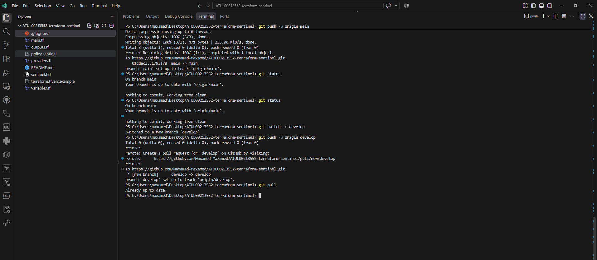

This screenshot confirms that the `develop` branch was created and pushed to GitHub. I used `develop` for the assignment work so that changes could be reviewed before being merged into the stable `main` branch.

### Screenshot 02: Project structure reorganised

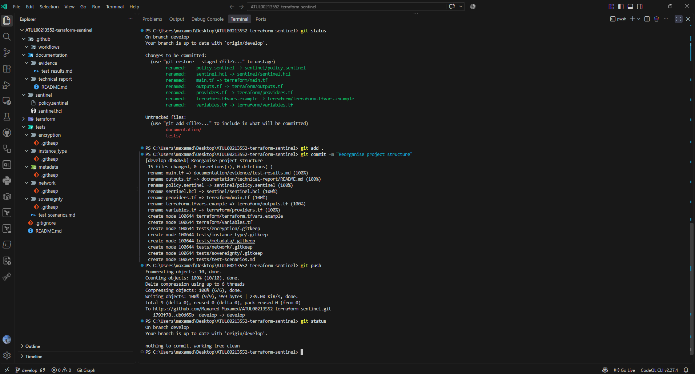

This screenshot shows the repository after the files were reorganised according to the assignment’s suggested structure.

The repository separates:

- Terraform configuration
- Sentinel policies
- Compliant and non-compliant mock tests
- Evidence screenshots
- Technical documentation
- GitHub Actions configuration

This structure keeps related files together and makes the project easier to review.

### Screenshot 03: Initial Terraform setup

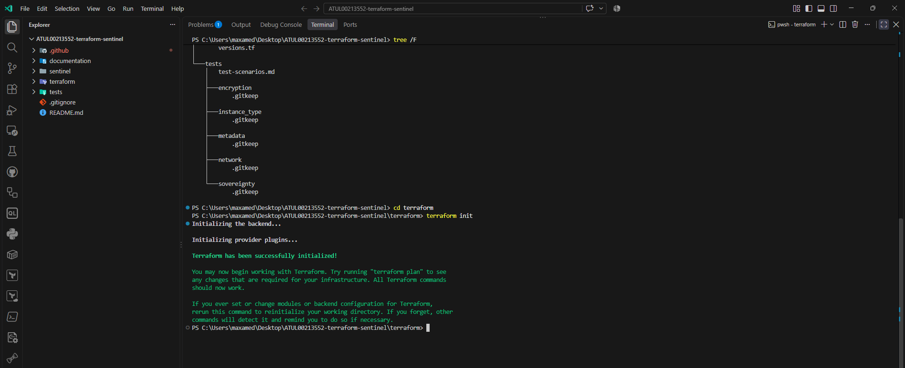

This screenshot records the initial Terraform setup. Terraform was run from the `terraform` directory to prepare the working directory and obtain the required provider information.

### Screenshot 04: Terraform initialisation and validation

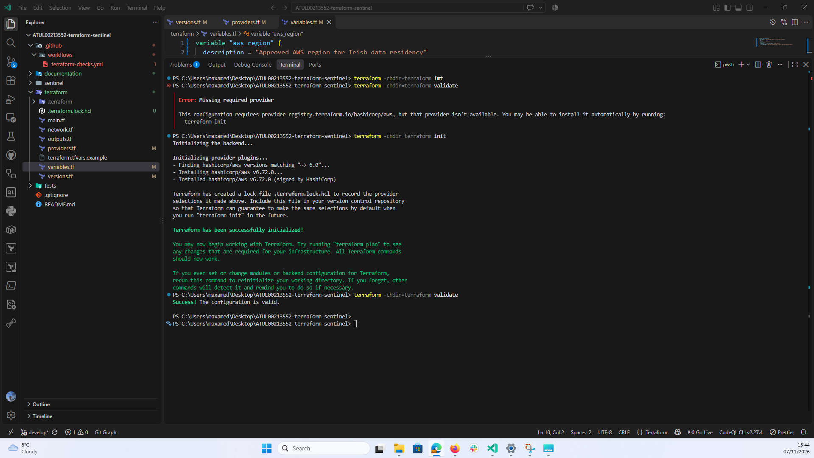

This screenshot records the Terraform initialisation and validation results.

A successful `terraform init` confirms that Terraform prepared the working directory and provider dependencies. A successful `terraform validate` confirms that Terraform found the configuration to be internally valid.

Validation does not mean that the infrastructure was deployed to AWS. It checks the structure and internal consistency of the Terraform configuration.

### Screenshot 05: EBS encryption policy tests

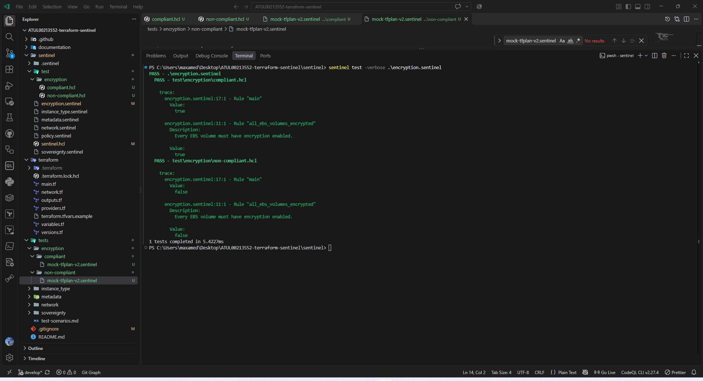

This screenshot shows the compliant and non-compliant tests for `encryption.sentinel`.

The compliant encrypted-volume mock returned:

```text
Value: true
```

The non-compliant unencrypted-volume mock returned:

```text
Value: false
```

Both cases display `PASS` because Sentinel returned the expected result for each test. The encrypted volume was accepted, while the unencrypted volume was rejected.

### Screenshot 06: EC2 instance-type policy tests

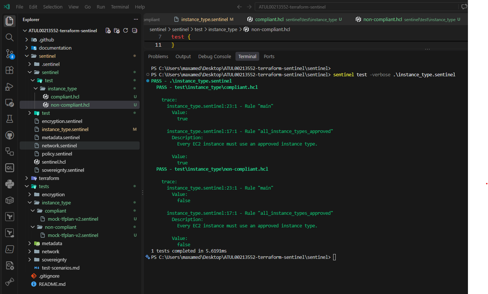

This screenshot shows the tests for `instance_type.sentinel`.

The compliant `t3.micro` mock returned:

```text
Value: true
```

The non-compliant `m5.large` mock returned:

```text
Value: false
```

The result confirms that the policy accepts the selected project instance types and rejects an instance type outside the approved list.

### Screenshot 07: IMDSv2 policy tests

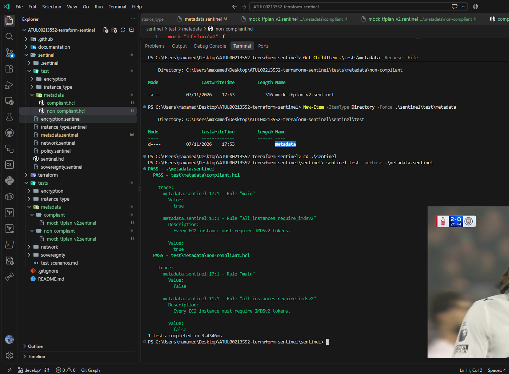

This screenshot shows the tests for `metadata.sentinel`.

The compliant mock uses `http_tokens = "required"` and returned:

```text
Value: true
```

The non-compliant mock uses `http_tokens = "optional"` and returned:

```text
Value: false
```

The result confirms that the policy requires IMDSv2 for the tested EC2 instance configuration.

### Screenshot 08: Network security policy tests

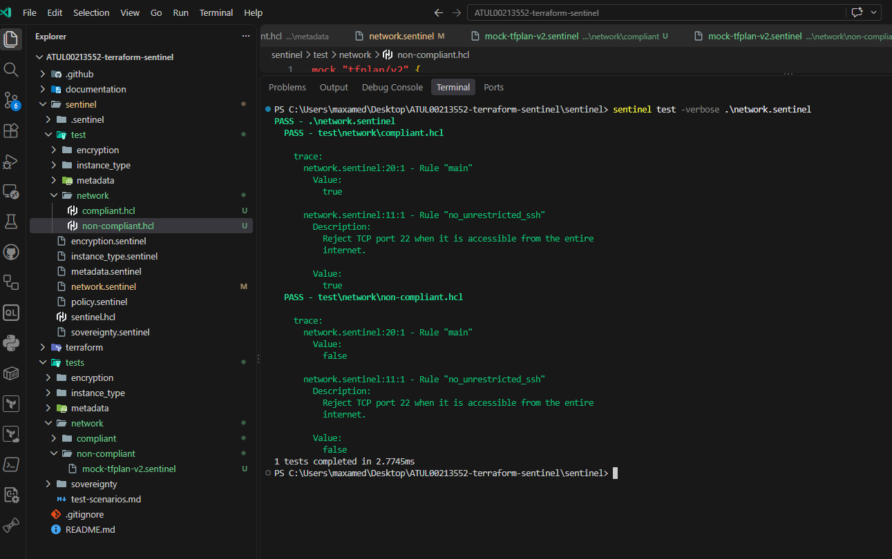

This screenshot shows the tests for `network.sentinel`.

The compliant example limits SSH access to `10.0.0.0/24` and returned:

```text
Value: true
```

The non-compliant example opens TCP port 22 to `0.0.0.0/0` and returned:

```text
Value: false
```

The result confirms that the policy rejects unrestricted inbound SSH for the tested `aws_vpc_security_group_ingress_rule` resource.

### Screenshot 09: Digital-sovereignty policy tests

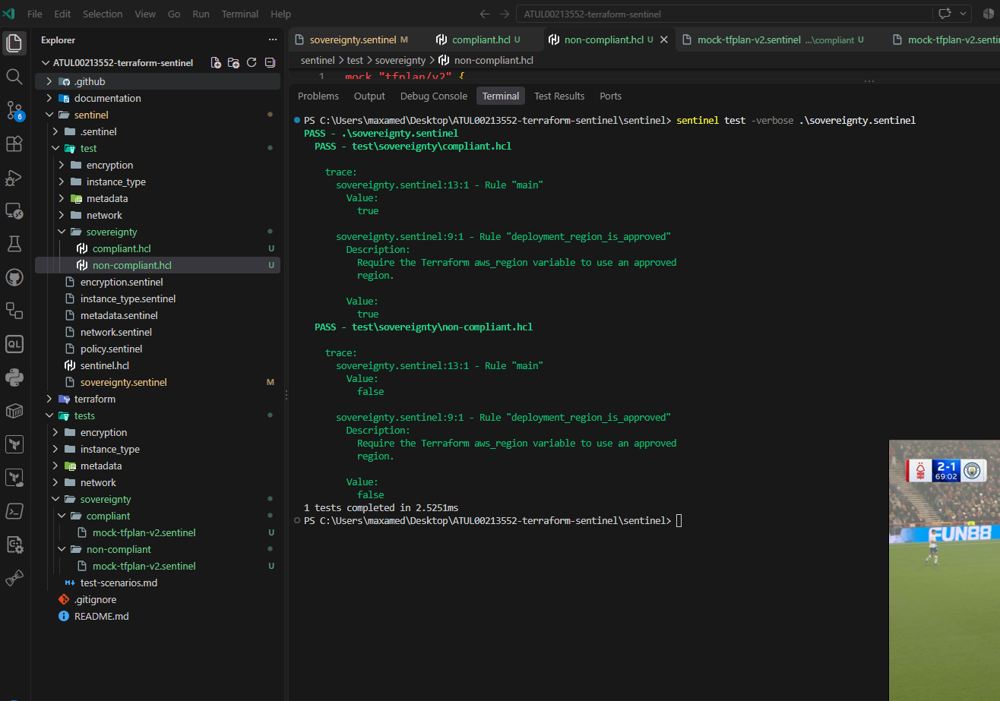

This screenshot shows the tests for `sovereignty.sentinel`.

The compliant `eu-west-1` region returned:

```text
Value: true
```

The non-compliant `us-east-1` region returned:

```text
Value: false
```

The result confirms that the policy restricts the Terraform `aws_region` variable to the approved Ireland region.

### Screenshot 10: Terraform supply-chain policy tests

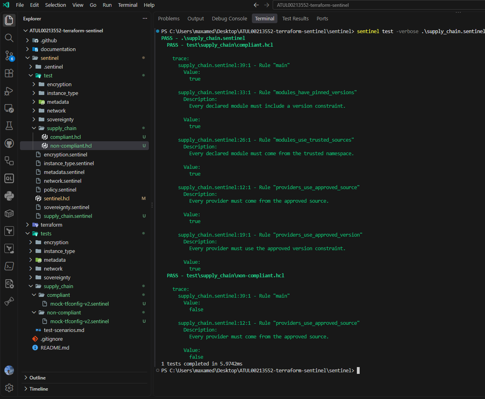

This screenshot shows the tests for `supply_chain.sentinel`.

The compliant mock uses:

- The approved HashiCorp AWS provider source
- The approved `~> 6.0` provider constraint
- A trusted Terraform module namespace
- A module version constraint

The compliant configuration returned:

```text
Value: true
```

The non-compliant mock uses:

- An unapproved provider publisher
- An unapproved provider constraint
- An untrusted module source
- An empty module version constraint

The non-compliant configuration returned:

```text
Value: false
```

The current Terraform configuration does not use an external module. The module controls were tested with `tfconfig/v2` mock data to show how the policy would behave if modules were added later.

### Screenshot 11: Complete Sentinel test suite

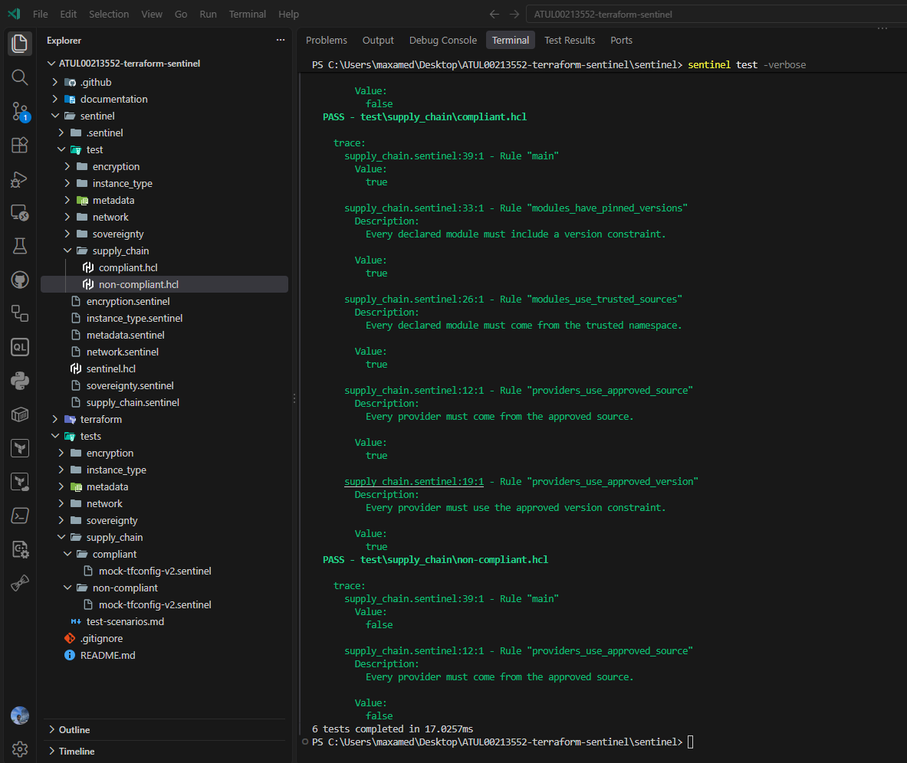

This screenshot records the final complete Sentinel test run.

The output confirms that all six implemented policies were discovered and tested:

```text
PASS - encryption.sentinel
PASS - instance_type.sentinel
PASS - metadata.sentinel
PASS - network.sentinel
PASS - sovereignty.sentinel
PASS - supply_chain.sentinel
```

The final summary reported:

```text
6 tests completed
```

This is the combined evidence that all six policies passed their compliant and non-compliant test scenarios.

### Screenshot 12: Terraform plan created

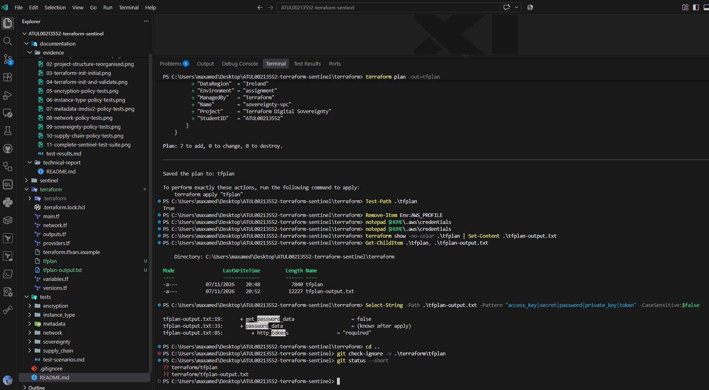

This screenshot records the successful creation of the saved Terraform plan.

Terraform reported:

```text
Plan: 7 to add, 0 to change, 0 to destroy.
Saved the plan to: tfplan
```

## Terraform plan evidence

Terraform created a saved plan named:

```text
terraform/tfplan

Plan: 7 to add, 0 to change, 0 to destroy.
terraform/tfplan-output.txt
```


## Evaluation of Policy-as-Code

In this project, Sentinel changed each security requirement into a rule that could be tested before deployment.

The mock results show that approved values returned `true`, while values that broke a rule returned `false`. The decisions are visible in source code and supported by test files, screenshots, and Git history.

The approach worked well for information available in Terraform configuration or plan data, including:

- EBS encryption
- EC2 instance type
- EC2 metadata options
- Security-group ingress rules
- AWS region
- Provider source
- Provider version constraint
- Module source
- Module version constraint

The result still depends on the quality of the policy. A policy can miss an alternative Terraform resource, a new provider field, or a configuration pattern that was not considered.

Mock tests also prove only the scenarios that were written. They do not cover every possible Terraform configuration.

## Limitations of the current implementation

The current implementation has the following limits:

- The policies were tested locally with Sentinel mocks rather than through a completed HCP Terraform policy set.
- The project does not show a real AWS deployment.
- The sovereignty policy checks the `aws_region` variable but cannot prove the location of every log, backup, administrative action, or connected service.
- The network policy checks `aws_vpc_security_group_ingress_rule`, so other security-group resource patterns would need additional checks.
- The network policy checks IPv4 `0.0.0.0/0` but does not check IPv6 `::/0`.
- Sentinel evaluates configuration and plan information but does not continuously monitor resources after deployment.
- Manual AWS Console changes could create infrastructure drift after policy evaluation.
- The supply-chain policy checks declared sources and constraints but cannot prove that provider or module code is free from malicious behaviour.
- Module controls were tested with mocks because the Terraform configuration does not currently use an external module.

## Suggested future improvements

The following items are suggestions and are not part of the current implementation:

- Connect the repository to an HCP Terraform workspace and Sentinel policy set.
- Use AWS Config to monitor deployed resources after Terraform runs.
- Use AWS CloudTrail to review administrative activity.
- Add drift detection for changes made outside Terraform.
- Expand the network policy to cover inline `aws_security_group` ingress blocks.
- Add IPv6 checks for `::/0`.
- Add policies for backup location and replication.
- Add controls for public storage access.
- Add an approved Amazon Machine Image policy.
- Add KMS key requirements.
- Add an external Terraform module only after selecting and reviewing a specific trusted module and version.

## Security considerations

The `.gitignore` file excludes local Terraform directories, state files, variable files, plan files, environment files, and the Sentinel cache.

Sensitive information must not be committed, including:

- AWS access keys
- AWS secret keys
- Passwords
- Private keys
- Account details
- Real `terraform.tfvars` files
- Terraform state files
- Screenshots containing credentials

Root-user AWS access keys should not be used for ordinary Terraform work. A least-privilege IAM role, IAM user, or approved temporary authentication method should be used instead.

## Git workflow

Development work is stored on the `develop` branch. The `main` branch is kept as the stable branch.

Separate commits were created for:

- EBS encryption
- EC2 instance types
- IMDSv2
- Network security
- Digital sovereignty
- Supply-chain security
- Complete test-suite evidence

After the code, evidence, README, test documentation, and technical report have been reviewed, a pull request can be created from `develop` into `main`.

## Use of AI tools

Microsoft Copilot, powered by GPT-5.6, was used during this project to:

- Explain unfamiliar Git, Terraform, and Sentinel commands
- Review Sentinel syntax
- Help diagnose terminal errors
- Suggest a structure for Sentinel mock tests
- Improve the organisation of the repository
- Identify suitable screenshot points
- Improve the clarity and grammar of the documentation
- Locate relevant official AWS and HashiCorp documentation

Representative prompts included:

- “Please start from beginner level.”
- “Are we meant to follow this folder structure?”
- “Help me create compliant and non-compliant Sentinel tests.”
- “Why is the `tfplan/v2` import not available?”
- “Tell me when I need to take a screenshot for the assignment.”
- “Please use clear, natural academic English in the README.”
- “Do not add technical features that I have not implemented.”

I created and managed the repository, ran the Terraform and Sentinel commands, reviewed the policy logic, corrected syntax and file-location errors, captured the evidence, and managed the Git commits.

Copilot suggestions were checked against terminal results, the assignment instructions, and official AWS and HashiCorp documentation rather than accepted automatically.

## Conclusion

The project demonstrates how Terraform and Sentinel can be used together to check infrastructure requirements before deployment.

Six Sentinel policies were created and tested. The policies accepted the compliant mock configurations and rejected the non-compliant configurations as expected.

The project also shows the limits of Policy-as-Code. Region selection alone does not provide complete digital sovereignty, and plan-time checks do not replace runtime monitoring, identity controls, dependency review, legal analysis, or post-deployment compliance checks.

## References

1. Amazon Web Services, “Amazon EBS encryption.” Available at: [AWS EBS encryption documentation](https://docs.aws.amazon.com/ebs/latest/userguide/ebs-encryption.html)

2. Amazon Web Services, “Modify instance metadata options for existing instances.” Available at: [AWS EC2 metadata-options documentation](https://docs.aws.amazon.com/AWSEC2/latest/UserGuide/configuring-IMDS-existing-instances.md)

3. Amazon Web Services, “AWS Regions.” Available at: [AWS Regions documentation](https://docs.aws.amazon.com/global-infrastructure/latest/regions/aws-regions.html)

4. HashiCorp, “Dependency Lock File.” Available at: [Terraform dependency lock-file documentation](https://developer.hashicorp.com/terraform/language/files/dependency-lock)

5. HashiCorp, “tfconfig/v2.” Available at: [Sentinel tfconfig/v2 documentation](https://developer.hashicorp.com/sentinel/docs/features/terraform/tfconfig-v2)

6. HashiCorp, “Sentinel enforcement levels.” Available at: [Sentinel enforcement-level documentation](https://developer.hashicorp.com/sentinel/docs/concepts/enforcement-levels)

7. HashiCorp, “Sentinel CLI configuration file syntax.” Available at: [Sentinel configuration documentation](https://developer.hashicorp.com/sentinel/docs/configuration)

8. HashiCorp, “Terraform provider requirements.” Available at: [Terraform provider-requirements documentation](https://developer.hashicorp.com/terraform/language/providers/requirements)

9. HashiCorp, “Get started with Terraform and AWS.” Available at: [Terraform AWS tutorial](https://developer.hashicorp.com/terraform/tutorials/aws-get-started)
10. HashiCorp, “Terraform validate command.” Available at: [Terraform validate documentation](https://developer.hashicorp.com/terraform/cli/commands/validate)
11. HashiCorp, “Terraform plan command.” Available at: [Terraform plan documentation](https://developer.hashicorp.com/terraform/cli/commands/plan)
12. HashiCorp, “Terraform show command.” Available at: [Terraform show documentation](https://developer.hashicorp.com/terraform/cli/commands/show)
13. HashiCorp, “Terraform fmt command.” Available at: [Terraform fmt documentation](https://developer.hashicorp.com/terraform/cli/commands/fmt)
14. HashiCorp, “Terraform init command.” Available at: [Terraform init documentation](https://developer.hashicorp.com/terraform/cli/commands/init)
15. HashiCorp, “Terraform output command.” Available at: [Terraform output documentation](https://developer.hashicorp.com/terraform/cli/commands/output)
16. HashiCorp, “Terraform validate command.” Available at: [Terraform validate documentation](https://developer.hashicorp.com/terraform/cli/commands/validate)