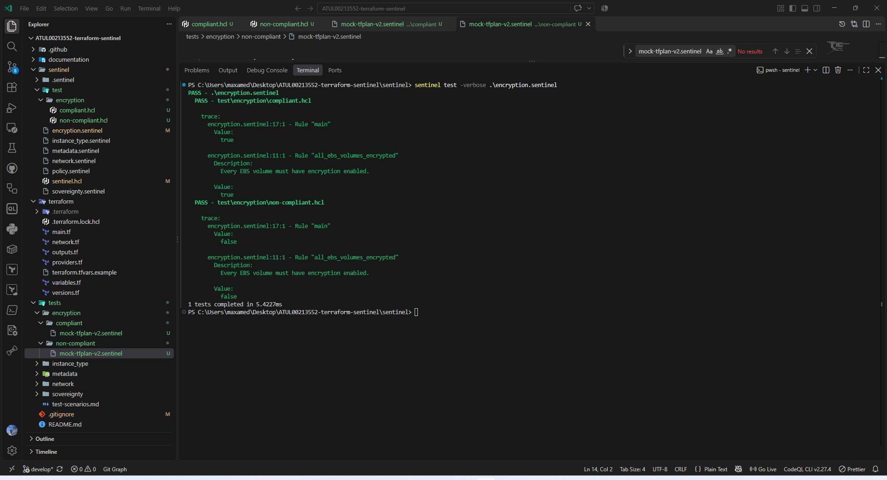
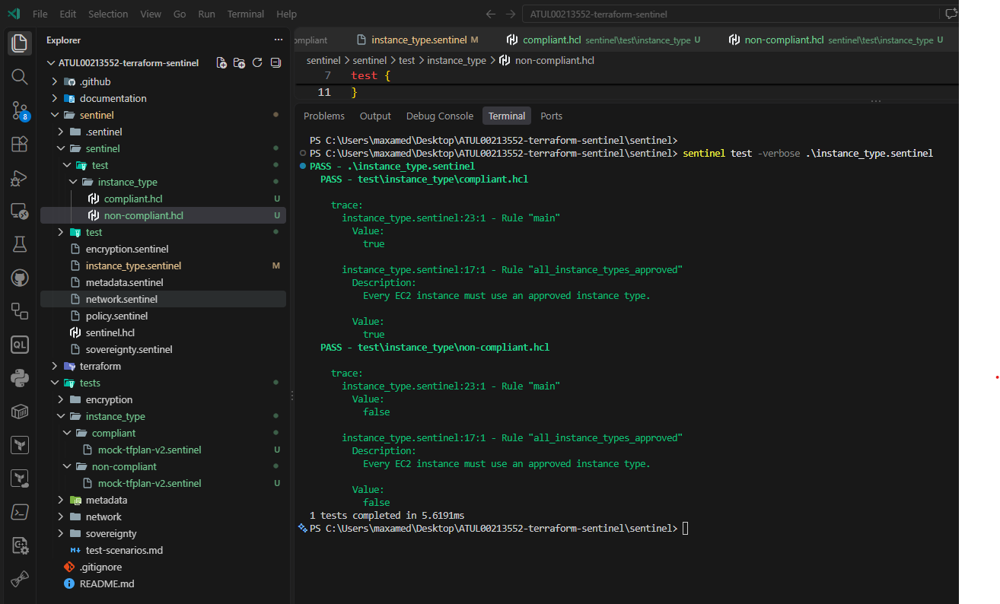
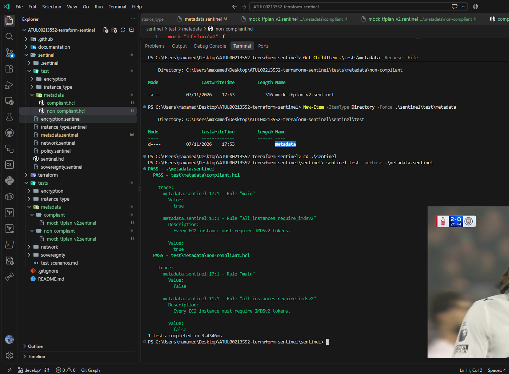
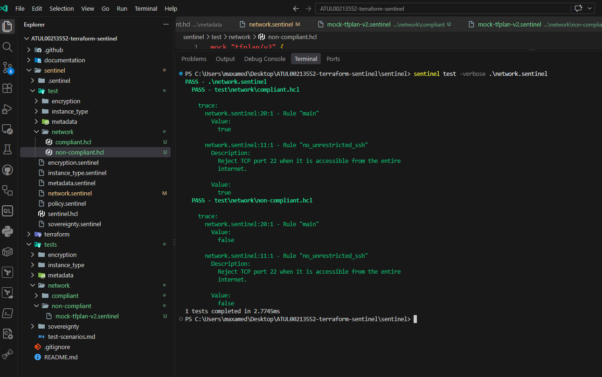
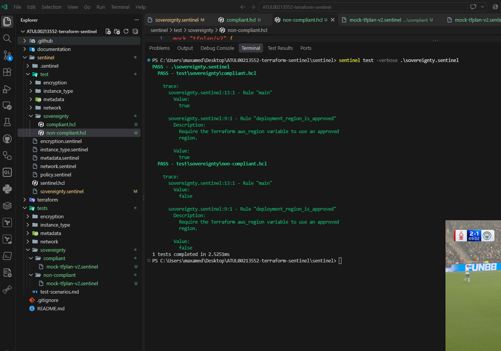
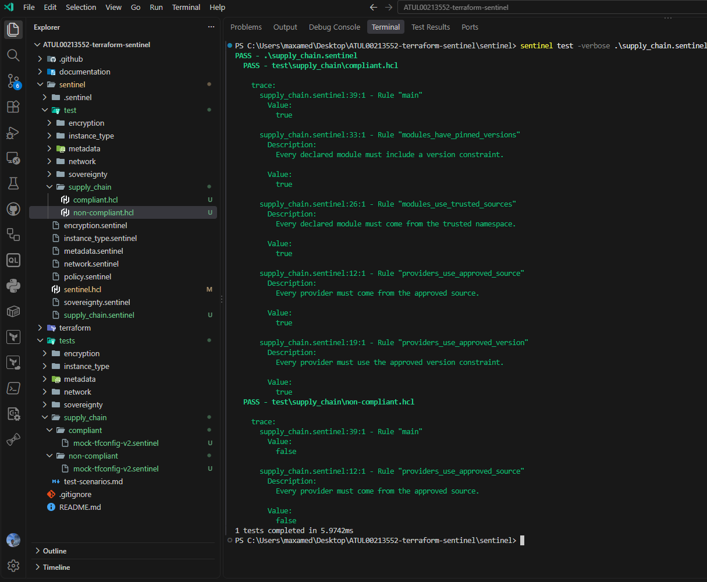
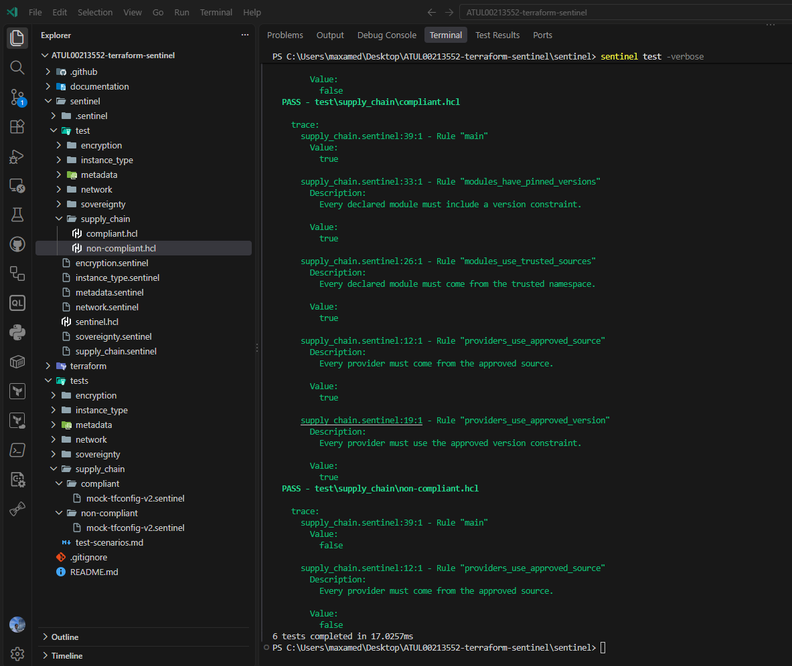
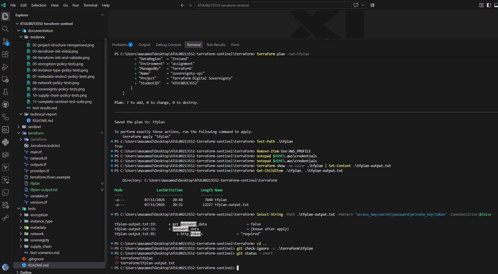

# Sentinel Policy Test Results

## Purpose

This document records the local Sentinel tests completed for the Terraform Sentinel assignment.

Each policy was tested with:

- One compliant mock expected to return `true`
- One non-compliant mock expected to return `false`

A non-compliant test showing `PASS` means that Sentinel correctly returned `false` and rejected the configuration as expected.

## Test environment

- Operating system: Windows 11 Pro
- Terminal: PowerShell
- Sentinel CLI version: `0.41.0`
- Development branch: `develop`
- Testing method: Local Sentinel mock data
- AWS deployment performed: No

## Test command

The complete test suite was run from the `sentinel` directory:

```powershell
sentinel test -verbose
```

The final output reported:

```text
PASS - encryption.sentinel
PASS - instance_type.sentinel
PASS - metadata.sentinel
PASS - network.sentinel
PASS - sovereignty.sentinel
PASS - supply_chain.sentinel
6 tests completed
```

## Results summary

| Policy | Compliant scenario | Result | Non-compliant scenario | Result |
|---|---|---:|---|---:|
| EBS encryption | Encryption enabled | `true` | Encryption disabled | `false` |
| Instance type | `t3.micro` | `true` | `m5.large` | `false` |
| Metadata | IMDSv2 required | `true` | IMDS tokens optional | `false` |
| Network | SSH limited to `10.0.0.0/24` | `true` | SSH open to `0.0.0.0/0` | `false` |
| Sovereignty | Region `eu-west-1` | `true` | Region `us-east-1` | `false` |
| Supply chain | Approved provider and module mock | `true` | Unapproved provider and module mock | `false` |

## EBS encryption test

Policy file:

```text
sentinel/encryption.sentinel
```

The compliant mock represents an encrypted EBS volume and returned `true`.

The non-compliant mock represents an unencrypted EBS volume and returned `false`.



## EC2 instance-type test

Policy file:

```text
sentinel/instance_type.sentinel
```

The compliant mock uses the approved `t3.micro` instance type and returned `true`.

The non-compliant mock uses `m5.large`, which is outside the approved list, and returned `false`.



## IMDSv2 test

Policy file:

```text
sentinel/metadata.sentinel
```

The compliant mock sets `http_tokens` to `required` and returned `true`.

The non-compliant mock sets `http_tokens` to `optional` and returned `false`.



## Network security test

Policy file:

```text
sentinel/network.sentinel
```

The compliant mock limits SSH access to `10.0.0.0/24` and returned `true`.

The non-compliant mock exposes TCP port 22 to `0.0.0.0/0` and returned `false`.



## Digital-sovereignty test

Policy file:

```text
sentinel/sovereignty.sentinel
```

The compliant mock uses the approved Ireland region, `eu-west-1`, and returned `true`.

The non-compliant mock uses `us-east-1` and returned `false`.



## Terraform supply-chain test

Policy file:

```text
sentinel/supply_chain.sentinel
```

The compliant mock uses:

- The approved HashiCorp AWS provider source
- The approved provider version constraint
- A trusted module namespace
- A module version constraint

The compliant mock returned `true`.

The non-compliant mock uses:

- An unapproved provider publisher
- An unapproved provider constraint
- An untrusted module source
- No module version constraint

The non-compliant mock returned `false`.

The current Terraform configuration does not use an external module. The module controls were tested with `tfconfig/v2` mock data.



## Complete Sentinel test suite

The final combined test run found and tested all six policy files successfully.



## Terraform plan result

A saved Terraform plan was created using a temporary least-privilege IAM user.

The plan reported:

```text
Plan: 7 to add, 0 to change, 0 to destroy.
Saved the plan to: tfplan
```

The binary plan is stored at:

```text
terraform/tfplan
```

A readable copy is stored at:

```text
terraform/tfplan-output.txt
```



The plan was not applied, so no AWS resources were created. The temporary AWS access key was deleted after the plan was generated.


## Conclusion

All six policies produced the expected results.

The compliant mocks returned `true`, while the non-compliant mocks returned `false`. The tests show that the implemented policies can distinguish the approved project configurations from the non-compliant scenarios represented by the mock data.

The tests did not deploy resources to AWS. They cover the scenarios included in this project and do not represent every possible Terraform configuration.