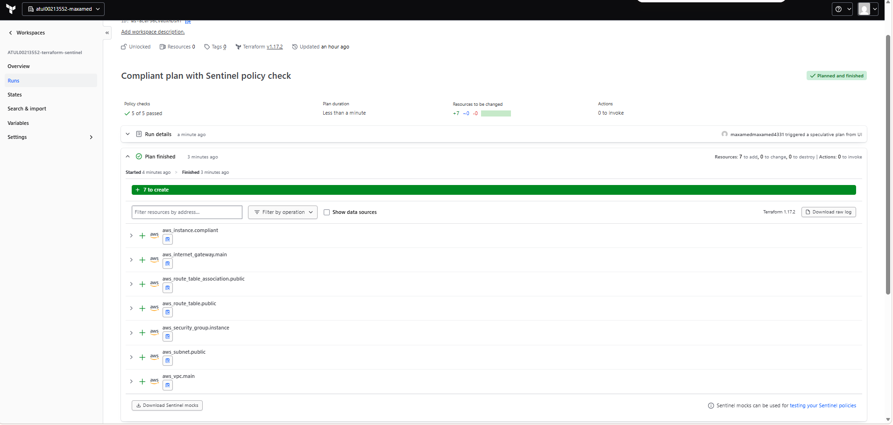
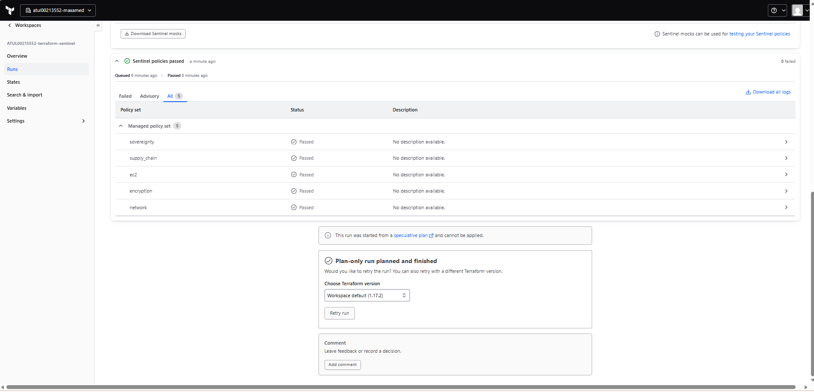
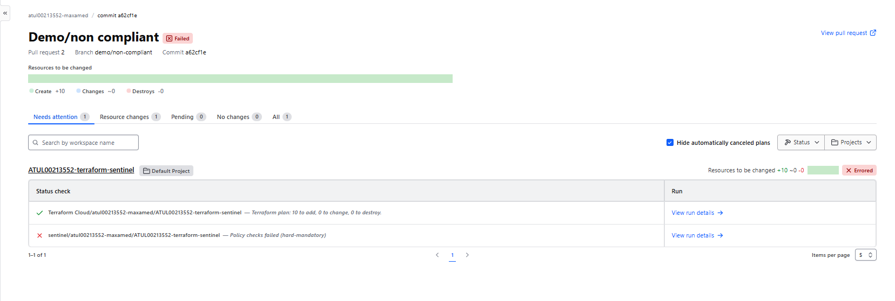
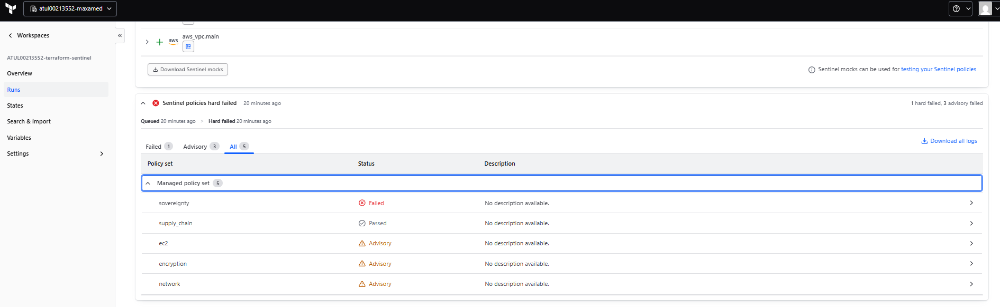
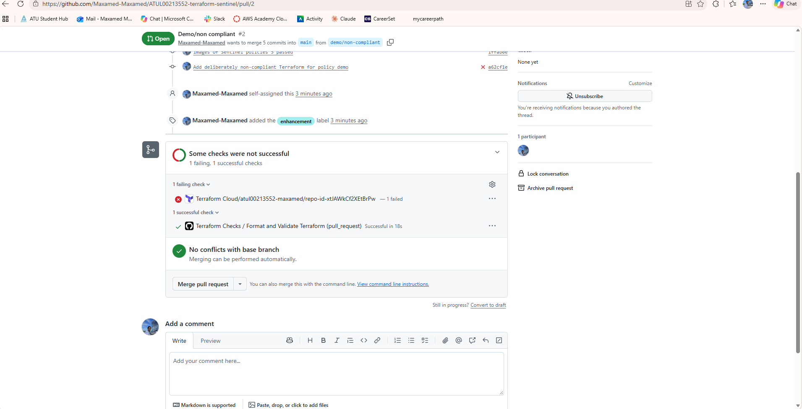
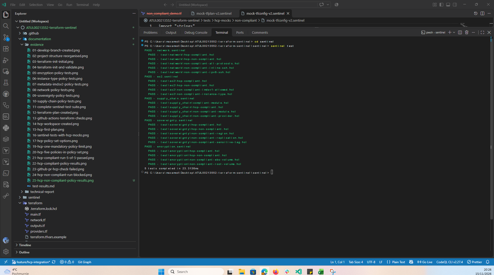
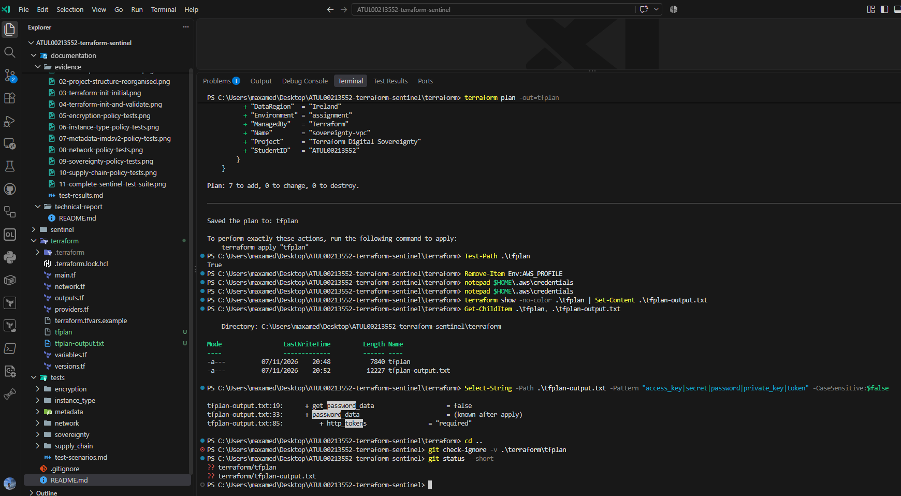

# Policy Evaluation Results

This document records the results of evaluating the five Sentinel policies, in HCP Terraform and locally.

## Environment

| Item | Value |
|---|---|
| HCP Terraform organisation | `atul00213552-maxamed` |
| Workspace | `ATUL00213552-terraform-sentinel` |
| Policy set | `ireland-sovereignty-policies` (individually managed, platform environment) |
| Terraform version in HCP Terraform | 1.17.2 |
| Sentinel version in HCP Terraform | 0.40.x (platform environment) |
| Sentinel CLI version locally | 0.41.0 |
| Local machine | Windows 11, PowerShell |
| AWS deployment performed | No. All runs were plan only. |

## 1. Compliant plan in HCP Terraform

Run name: "Compliant plan with Sentinel policy check". Source: `main` branch.

| Stage | Result |
|---|---|
| Plan | 7 to add, 0 to change, 0 to destroy |
| Policy check | 5 of 5 passed |

| Policy | Level | Result |
|---|---|---|
| `sovereignty` | Hard mandatory | Passed |
| `supply_chain` | Advisory | Passed |
| `ec2` | Advisory | Passed |
| `encryption` | Advisory | Passed |
| `network` | Advisory | Passed |





## 2. Non-compliant plan in HCP Terraform

Run name: "Demo/non compliant". Source: pull request 2 from the `demo/non-compliant` branch, which adds `terraform/non_compliant_demo.tf`.

| Stage | Result |
|---|---|
| Plan | 10 to add, 0 to change, 0 to destroy |
| Policy check | Hard failed: 1 hard failed, 3 advisory failed |

| Policy | Level | Result | Cause in the demo file |
|---|---|---|---|
| `sovereignty` | Hard mandatory | Failed | EBS volume in `us-east-1`, tagged sensitive with no `DataResidency` tag |
| `supply_chain` | Advisory | Passed | The approved provider is still used |
| `ec2` | Advisory | Failed | `m5.large` instance with `http_tokens = "optional"` |
| `encryption` | Advisory | Failed | Unencrypted EBS volume and unencrypted root volume |
| `network` | Advisory | Failed | SSH open to `0.0.0.0/0` |

The plan stage succeeded, so the configuration was valid Terraform. The run was stopped by the hard mandatory policy before the apply stage.







## 3. Local Sentinel tests

Command, run from the `sentinel` directory:

```powershell
sentinel test
```

Result: all five policies pass, 22 test cases.

| Policy | Test cases | Against HCP compliant mocks | Against HCP non-compliant mocks | Focused mocks |
|---|---:|---|---|---:|
| `sovereignty` | 5 | `true` | `false` | 3 |
| `supply_chain` | 4 | `true` | Not used | 3 |
| `ec2` | 4 | `true` | `false` | 2 |
| `encryption` | 4 | `true` | `false` | 2 |
| `network` | 5 | `true` | `false` | 3 |

Each test case is described in `tests/test-scenarios.md`.



## 4. Terraform plan file

A saved plan was created locally with `terraform plan -out=tfplan` and is stored at `terraform/tfplan`. A readable copy is at `terraform/tfplan-output.txt`. It reports 7 resources to add, the same as the compliant HCP Terraform run.



## 5. HCP Terraform configuration evidence

| Screenshot | Shows |
|---|---|
| `14-hcp-workspace-created.png` | Workspace linked to the GitHub repository |
| `15-hcp-first-plan.png` | First successful plan in HCP Terraform |
| `16-sentinel-tests-with-hcp-mocks.png` | First local test run against real HCP Terraform mock data |
| `17-hcp-policy-set-options.png` | Version control policy sets are not available on the Free edition |
| `19-hcp-one-mandatory-policy-limit.png` | Only one mandatory policy is allowed on the Free edition |
| `20-hcp-five-policies-in-policy-set.png` | The five policies in the policy set |

## 6. Earlier evidence

Screenshots 01 to 13 come from the first version of the project. Screenshots 05 to 11 show six earlier policies tested against hand-written mocks. Those policies were replaced after testing against real plan data showed that they did not cover the resources in the Terraform configuration.

## Conclusion

The compliant plan passed every policy and the non-compliant plan was stopped in HCP Terraform before apply. The local tests reproduce both results from the same plan data and cover each failure case separately. Only the sovereignty policy can stop a run on the Free edition. The other four report their failures as advisory.
